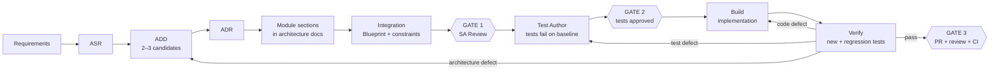

# Prompt.md — Coding Agent Workflow

> **Purpose:** The order in which work happens once a requirement is approved: software architecture, review, tests, implementation and verification, with the human gates between them.
> **Authoritative for:** workflow and gates only. Permissions, structure and verification rules live in the documents referenced below and are not repeated here.
> **Maintained by:** humans.
> **Last updated:** 2026-11-12

## 0. Golden Rule

> **No agent goes straight from "task received" to "code written".** Code is written only after the architecture has passed SA Review and the tests have been approved.

The approved SA documents together form the execution plan the course requires before code generation:

| Course element | Where it is |
|---|---|
| Traceability | `docs/architecture/trace-matrix.md` |
| Interface contract | ADR §5 Components and Interfaces |
| Scope boundaries | ADR §3 and `structural-constraints.md` §10 |
| Testing strategy | `verification-constraints.md` §7 |
| Steps | ADR §9 Implementation Steps |

Tests and implementation are written by different roles: Test Author writes the tests, Build writes the code that makes them pass, and neither changes the other's work.

## 1. Before Any Task

1. Read the documents in `AGENTS.md` §2.
2. Confirm the current role (Plan, Test Author, Build or Verify), the requirement ID (RID) and what the role may write (`docs/architecture/permission-model.md` §2–§3). The task ID is the RID, e.g. `REQ-005`.
3. Confirm the task's state: Plan needs the requirement `approved` in `docs/req/requirements.yaml`; Test Author needs Gate 1; Build needs Gate 2; Verify needs the build report.
4. If anything is missing or ambiguous, ask the human; do not guess.

## 2. Workflow at a Glance

| # | Step | Who | Output |
|---|---|---|---|
| 1 | ASR, ADD, ADR, module sections | Each module owner, optionally with the Plan agent | EVAL entry, ADR, module sections (§3) |
| 2 | Integration | The member the team assigns to each shared document | Blueprint and integrated architecture and constraint documents (§4) |
| 3 | SA Review — **Gate 1** | Whole team | `SA-NNN` record in `docs/review-memo.md`; ADRs *Accepted* |
| 4 | Test authoring | Test Author | Tests; baseline run in `docs/test-reports/<RID>.md` |
| 5 | Test approval — **Gate 2** | Human reviewer | Approved test commit in `docs/approvals/<RID>.md` |
| 6 | Implementation | Build | Code; `docs/build-reports/<RID>.md` |
| 7 | Verification and fixes | Verify, then Test Author or Build | Verification in `docs/test-reports/<RID>.md` |
| 8 | PR, review, CI — **Gate 3** | Two other members, CI | Merged PR |

## 3. Phase 1 — Software Architecture (per module)

Each module owner works on the module listed for their requirements in `architecture-blueprint.md` §4. The Plan agent may draft; the owner decides.

1. **ASR.** From `docs/req/requirements.yaml`, pick the requirements of the module that shape the architecture and the acceptance criteria (C-/M-) that matter.
2. **ADD.** Propose 2–3 candidate solutions and compare pros, cons, complexity and offline testability in a new entry of `docs/architecture/evaluation-table.md`.
3. **ADR.** Record the decision in `docs/architecture/adr/NNN-<slug>.md` from `000-template.md`: the choice, why, the rejected options, the components and interfaces, and the implementation steps.
4. **Module sections.** Add the module's part to each shared document that applies; skip a document the module does not touch.

| Document | Module adds | Required when |
|---|---|---|
| `docs/architecture/invariants.md` | Invariants, enforcing component, verification, fallback | Always for `safety_relevant` or `invariant`-type requirements |
| `docs/architecture/memory-design.md` §5 | State fields, ownership, lifecycle | The module adds or changes state |
| `docs/architecture/runtime-policy-catalog.md` §2 | Exception, retry, degradation and failure policies | The module handles failures |
| `docs/architecture/trace-matrix.md` | Architecture component and verification method for each REQ | Always |
| `docs/code-governance/structural-constraints.md` §10 | Module path, interface, allowed and forbidden dependencies | Always |
| `docs/code-governance/verification-constraints.md` §7 | Normal, exception, boundary and regression cases per C-/M-/INV | Always |

## 4. Integration and SA Review — Gate 1

1. **Integration.** For each shared document, the assigned member merges the module sections into the system-level sections, unifies IDs, and checks for conflicts: overlapping responsibilities, dependencies outside `structural-constraints.md` §5, state fields written by two modules, and criteria or invariants without a test case. The architecture blueprint is then written from the accepted ADRs: components, interfaces, dependencies, data flow and deterministic boundaries.
2. **SA Review.** The whole team reviews the ADRs and integrated documents. The result is recorded as `SA-NNN` in `docs/review-memo.md`; accepted ADRs change status to *Accepted*; for each requirement that passes, the human records Gate 1 in `docs/approvals/<RID>.md` with the SA-NNN reference.

No agent performs or forges a gate.

## 5. Phase 2 — Test Authoring

1. Write the tests for the module's cases in `verification-constraints.md` §7, in `test/offline/` (and `test/live/` where a case needs a real model), following `verification-constraints.md` §3. Tests target the interfaces in the accepted ADR, not an implementation.
2. Run them on the baseline and confirm each fails for the expected reason — a missing behaviour, not an import error or a broken fixture. A test that passes on the baseline does not prove the requirement; rewrite it or report it.
3. Record each command, the failing tests and their failure reasons in the "Baseline" section of `docs/test-reports/<RID>.md`, and commit the tests.

Test Author does not change source code. If an interface in the ADR cannot be tested as written, stop and report it.

## 6. Gate 2 — Test Approval

A human reviewer checks the test commit: every case in the module's §7 table has a test, each test checks the requirement rather than an implementation detail, and the baseline failures have the expected reasons. The reviewer records the approved commit in `docs/approvals/<RID>.md`. A later change to an approved test needs a new Gate 2.

## 7. Phase 3 — Implementation

**Entry condition:** Gate 2 is recorded.

1. Read the accepted ADR, the blueprint, the module's section in `structural-constraints.md` §10 and the governance rules.
2. Implement the ADR's implementation steps within the module's scope until the approved tests pass.
3. Run the checks in `permission-model.md` §4 and record each command and its result in `docs/build-reports/<RID>.md`. CI on the PR is the authoritative run.
4. Draft the PR description and the proposed entries for `docs/ai-use-log.yaml` and `docs/review-memo.md` in the build report; humans apply them.

Build never changes the approved tests. If a test looks wrong, stop and report it; the fix goes back to Test Author and Gate 2. If the implementation would deviate from the ADR, stop: that is an architecture change (§10). Build pushes only when the human confirms.

## 8. Phase 4 — Verification and Fixes

Verify runs the new tests, the boundary and exception cases, and every existing offline suite, plus any live or human checks the module's §7 table requires, and confirms that the tests in the PR are the approved ones. Results go to the "Verification" section of `docs/test-reports/<RID>.md`, using the rules in `verification-constraints.md` §6.

Verify classifies each defect as a test, code or architecture defect and returns it to Test Author, Build, or the module owner (§10). It never edits source code, tests or thresholds.

## 9. Gate 3 — PR, Review and CI

The PR follows `AGENTS.md` §7: one improvement per branch, English Conventional Commits, at least two other members' approvals, all active CI gates green (`verification-constraints.md` §5). The PR review is recorded in `docs/review-memo.md`.

Artifacts that change in the same PR:

| Artifact | Written by |
|---|---|
| Tests | Test Author |
| Source | Build |
| `docs/test-reports/<RID>.md` | Test Author (Baseline), Verify (Verification) |
| `trace-matrix.md` row: code and test evidence | Module owner |
| `docs/ai-use-log.yaml`, `docs/review-memo.md` | Humans, from the drafts in the build report |
| Prompt or model change: `prompts/` version bump and semantic evaluation | Build (prompt), Verify (evaluation) |

## 10. Architecture Rework

When verification or implementation shows that the architecture itself is wrong, the module owner runs another ADD round: a new EVAL entry, a new ADR that supersedes the old one (or an amended ADR still *Proposed*), updated module sections, and another SA Review. Tests affected by the change go through Gate 2 again.

## 11. Closing a Requirement

The human advances the requirement's `status` in `requirements.yaml` (`approved → in_progress → implemented → verified`) once the Definition of Done in `verification-constraints.md` §8 is met. A requirement is never marked `verified` while a mandatory check is `FAIL`, `NOT_RUN` or `BLOCKED`.

## 12. Reporting and Conflicts

Report to the human in the format of `AGENTS.md` §8. Handle conflicting instructions as in `.opencode/rules.md` R7: report them and wait; never pick an interpretation silently.

## Appendix — Course Requirement Mapping

| Course requirement | Where it is met |
|---|---|
| Execution plan before code, then stop for approval | §0, §3, §4 |
| Test approval before implementation | §5, §6 |
| Human supervision with auditable artifacts | `docs/approvals/`, `docs/review-memo.md`, `docs/ai-use-log.yaml`, `transcripts/` |
| Requirements → architecture → build → verification chain | §3–§11 |
| A decision where model output is gated by deterministic code | Requirements marked `safety_relevant: true`; `structural-constraints.md` §7; blueprint §8 |
| Six blocking CI gates | `verification-constraints.md` §5 |
| Traceability Req → Design → Code → Test → Monitor | `trace-matrix.md`, §3, §9 |
| Artifacts that evolve with the code | §9, §10 |
